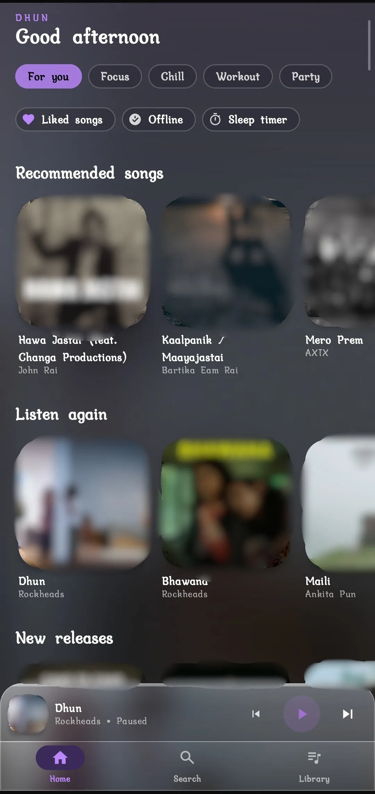
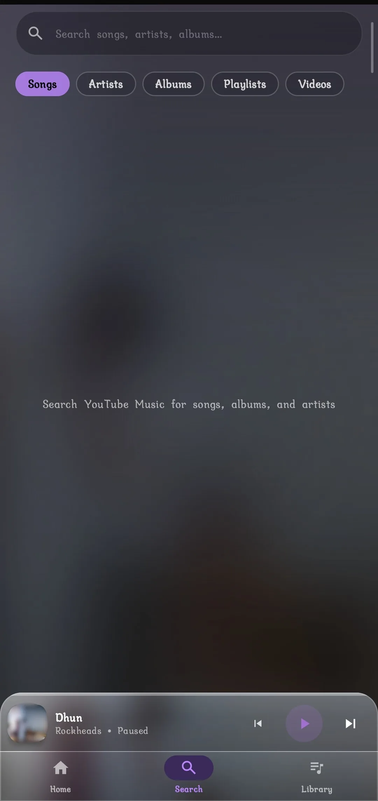
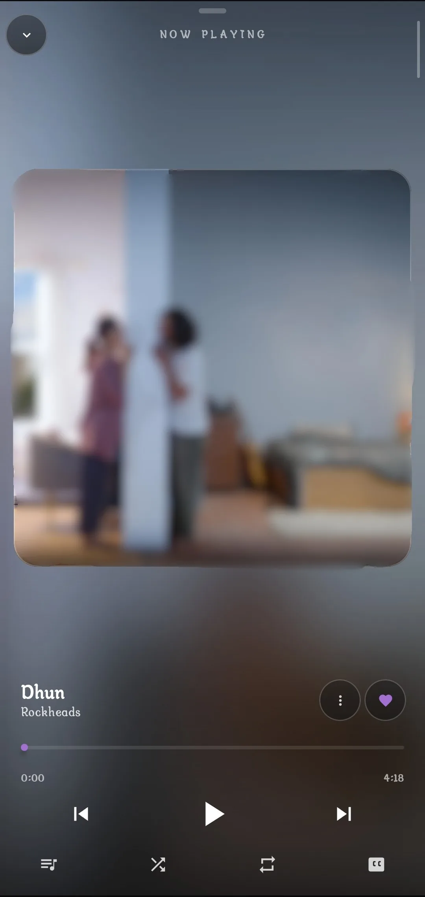
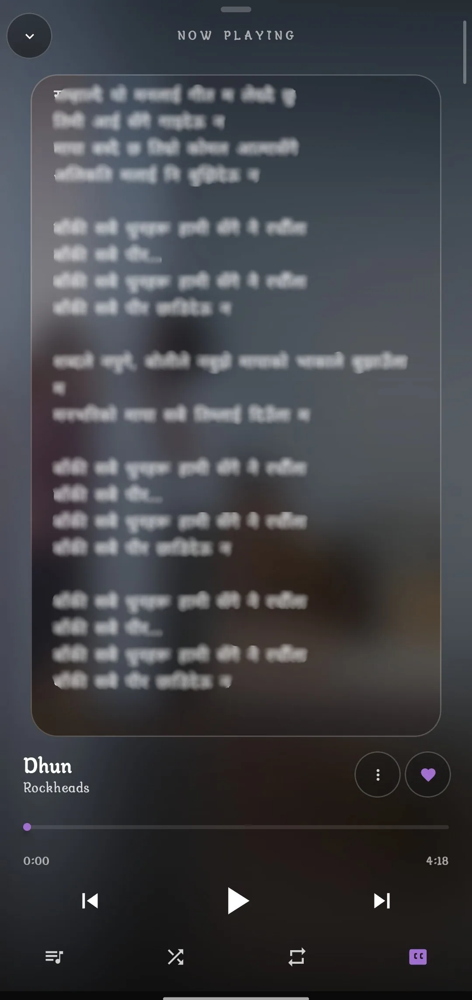
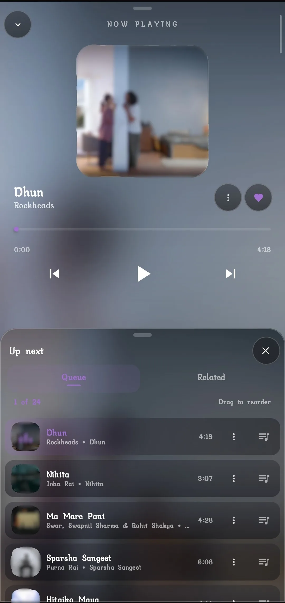
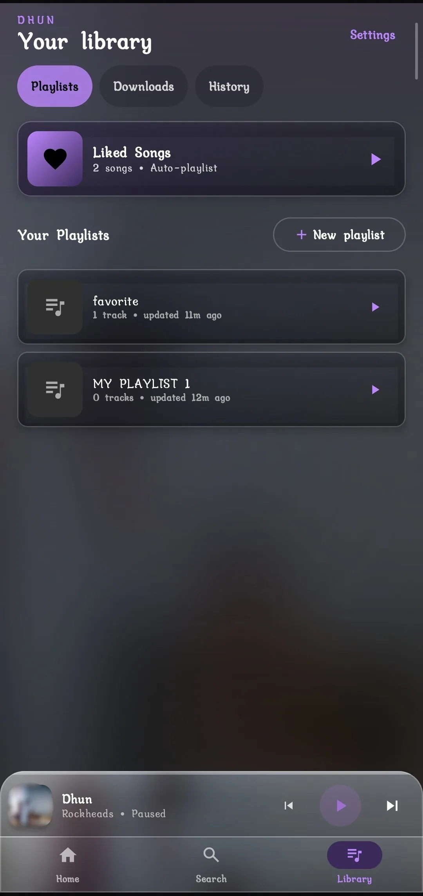
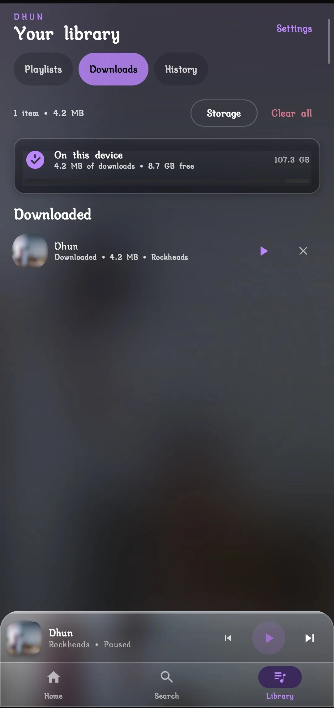
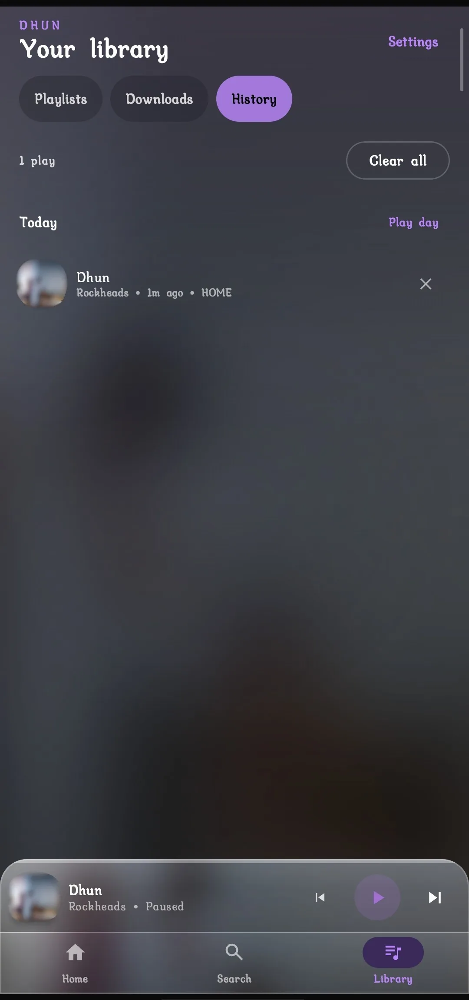
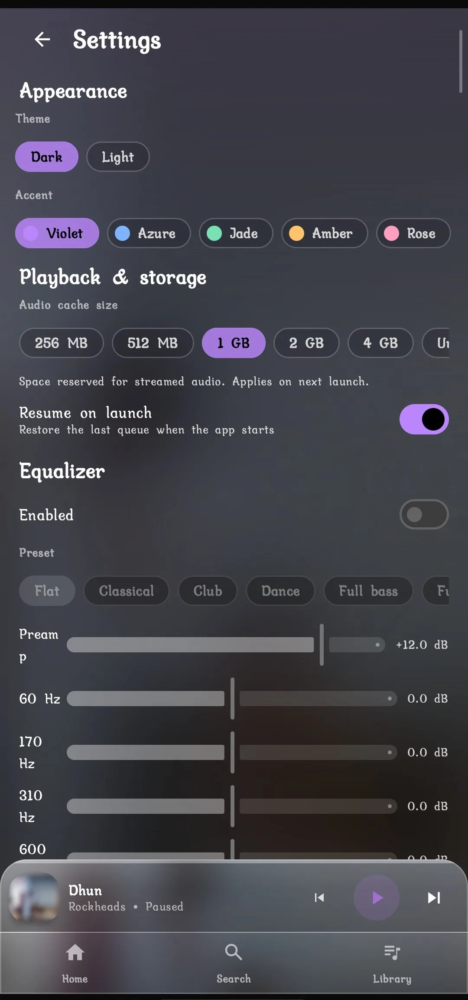
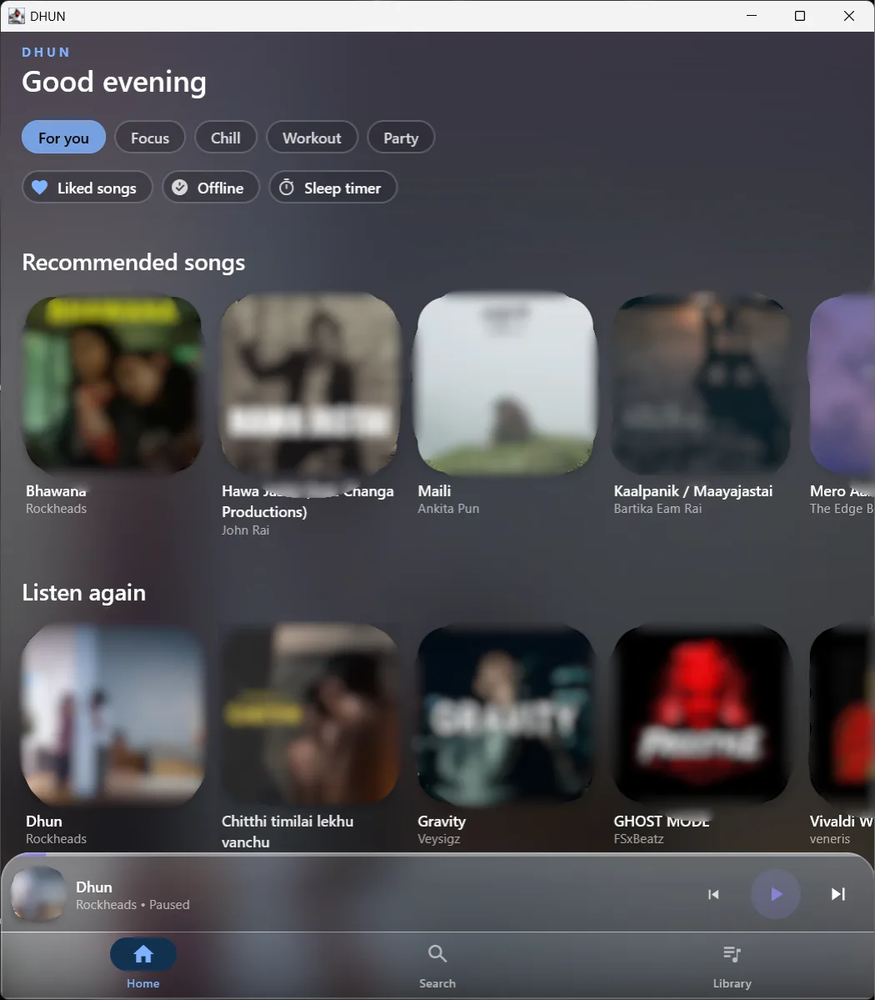

# DHUN

[Features](https://99ggprooo00-code.github.io/DHUN/features/) · [Source](https://github.com/99ggprooo00-code/DHUN)

DHUN (धुन) is a free, open-source, cross-platform, **multi-source music client**.
**YouTube / YouTube Music is the first implementation priority. Spotify is a
planned additional source, not implemented**; its work is deferred pending
technical, account/Premium, policy, legal, playback, privacy and cost gates.
Other sources may be evaluated using the same evidence-based process.

**Available code differs by build:** Android and desktop currently use YouTube
Music through an unofficial InnerTube client and stream resolvers. The separate
browser client uses **JioSaavn through community-run API wrappers**, not YouTube
or Spotify. Those paths have different capabilities and verification limits.
See the authoritative [product direction](docs/PRD.md#1-product-definition-and-source-of-truth),
[provider matrix](docs/research/05-source-capability-matrix.md) and
[ADR-010](docs/decisions/ADR-010-multi-source-provider-direction.md).

> **Pre-release:** `v1.00.002` is an experimental build, not a stable or store-ready release. Playback depends on upstream YouTube behavior and can stop working without warning. Android and Windows hardware acceptance is still in progress. The rolling `test` build is restricted to repository collaborators.

## Native screenshots and separate browser entry points

> **Try it right now:** the web app runs at **[`99ggprooo00-code.github.io/DHUN/app/`](https://99ggprooo00-code.github.io/DHUN/app/)** — installable where the browser offers it, with an offline shell (not offline audio), keyboard shortcuts and the DHUN shell (or see the full token and screenshot walkthrough on **[`/ui/`](https://99ggprooo00-code.github.io/DHUN/ui/)**). Every screen below is captured from an Android phone or Windows desktop running DHUN `v1.00.001` (third-party artwork and lyrics blurred/redacted, not a grant of content rights; full provenance in [`docs/verification/SCREENSHOT_PROVENANCE.md`](docs/verification/SCREENSHOT_PROVENANCE.md)).

These are **historical native captures**, not browser capability screenshots.
Browser links below open only its current equivalents; no lyrics, downloads,
equaliser or native Windows integration is implied. Browser catalogue/audio
acceptance and native current-device acceptance remain separate.

### 1. Home & Search (Android)

| Home (`mock-home-phone`) | Search (`mock-search-phone`) |
| :---: | :---: |
|  |  |
| Greeting header, mood chips, Recommended songs, Listen again, docked mini-player, and bottom tabs.<br>[Open Home in `/app/` →](https://99ggprooo00-code.github.io/DHUN/app/) | Query bar and result-type filter chips (`All`, `Songs`, `Artists`, `Albums`, `Playlists`, `Videos`).<br>[Open Search in `/app/` →](https://99ggprooo00-code.github.io/DHUN/app/#/search) |

### 2. Full Player, Synced Lyrics & Up Next Queue (Android)

| Full Player (`mock-player-phone`) | Synced Lyrics (`mock-lyrics`) | Up Next Queue (`mock-queue-phone`) |
| :---: | :---: | :---: |
|  |  |  |
| Blurred colour-sampled artwork, seek scrubber, shuffle/repeat transport, and bottom actions.<br>[Open browser player (different features) →](https://99ggprooo00-code.github.io/DHUN/app/#/player) | Timestamped LRC lyrics overlay (`CC` active) with LRCLIB + YouTube Music fallback.<br>Browser lyrics unavailable; [browser limitations](docs/web-player/KNOWN-LIMITATIONS.md). | Reorderable `Up next` queue (`1 of 24`) and `Related` tab inside the expanded player.<br>[Open browser queue (no native Related tab) →](https://99ggprooo00-code.github.io/DHUN/app/#/player/queue) |

### 3. Library — Playlists, Offline Downloads & Listening History (Android)

| Playlists (`mock-playlists-phone`) | Downloads (`mock-downloads-phone`) | History (`mock-history-phone`) |
| :---: | :---: | :---: |
|  |  |  |
| Pinned `Liked Songs` folder, custom SQLDelight playlists, and `+ New playlist`.<br>[Open Playlists in `/app/` →](https://99ggprooo00-code.github.io/DHUN/app/#/library/playlists) | App-private resumable range downloads, storage usage bar, and `Clear all`.<br>Browser audio downloads unavailable; [browser limitations](docs/web-player/KNOWN-LIMITATIONS.md). | On-device chronological listening history with confirmation-backed `Clear all`.<br>[Open History in `/app/` →](https://99ggprooo00-code.github.io/DHUN/app/#/library/history) |

### 4. Settings, Equalizer & Windows Desktop (`v1.00.001` baseline; `v1.00.002` current)

| Settings & Equalizer (`mock-settings-phone`) | Windows Desktop (`mock-desktop-window`) |
| :---: | :---: |
|  |  |
| Dark/Light theme, 6 accents, cache cap, offline `About & Legal` pages, presets, preamp, and Equalizer.<br>[Open browser settings (no EQ/native cache controls) →](https://99ggprooo00-code.github.io/DHUN/app/#/settings) | Native Windows Compose Desktop window with 4-column grids, volume slider, system tray, and media keys.<br>[Open browser wide layout (not the Compose desktop app) →](https://99ggprooo00-code.github.io/DHUN/app/) |

## What the native Android and desktop builds include

- Home discovery, search, and artist, album, and playlist browsing.
- A personal library with liked songs, playlists, listening history, and downloads for offline playback.
- Android background playback with notification/media controls, plus a mini-player and full player.
- Queue management, shuffle, repeat, lyrics when available, and related-track/radio playback.
- A Windows desktop app with a system tray, media controls, and taskbar jump lists.
- Appearance and playback settings. Desktop audio uses the system's VLC/libVLC installation.

The web app at [`/app/`](https://99ggprooo00-code.github.io/DHUN/app/) is a separate,
experimental client, not a mock-up. It uses JioSaavn via `saavn.dev`,
`saavn.sumit.co` and `saavnx.vercel.app`, with audio/artwork from `*.saavncdn.com`.
It keeps a local browser library, exposes failures and labelled silent samples,
and caches only its interface for offline opening. **No browser audio downloads,
equaliser or lyrics are implemented.** Its legal drafts describe browser data
flows separately from the native app. Live catalogue access and audible playback
from the deployed origin remain unverified; see [browser status](docs/web-player/IMPLEMENTATION-STATUS.md).

## Install the pre-release

Download builds from the [DHUN v1.00.002 pre-release](https://github.com/99ggprooo00-code/DHUN/releases/tag/v1.00.002). Read the [installation guide](docs/INSTALL.md) first, and verify each file against its `.sha256` sidecar before installing. These builds use a public test signing key and are not intended for a daily-use device. Security reports: see [SECURITY.md](SECURITY.md). Release rules: see [release policy (proposal)](docs/releases/RELEASE-POLICY.md).

- **Android:** Android 7.0 (API 24) or newer. Install the universal APK unless you specifically need an ABI split.
- **Windows:** install the MSI per user. Windows SmartScreen may warn because the installer is unsigned; playback requires VLC installed separately.

## Build from source

Requires JDK 17. Android builds also need Android SDK 35 and `ANDROID_HOME` set.

```bash
./gradlew :app-android:assembleDebug
./gradlew :app-desktop:run
./gradlew :shared:jvmTest
```

The committed Android test key is public and for test builds only. Do not use it for a store release. The Windows MSI's internal version is an installer-upgrade sequence, not the DHUN app version.

## Status and scope

DHUN has no DHUN-hosted account, no cloud sync and no iOS app. It has two primary native targets (Android, Windows; hardware acceptance pending) and a web app at `/app/`. Native YouTube extraction is a maintenance and unresolved policy risk; browser JioSaavn depends on unofficial community services and browser/CORS restrictions. Neither integration has an availability guarantee, and passing CI does not replace playing a track on a real device.

## Website

The [DHUN site](https://99ggprooo00-code.github.io/DHUN/) is published by GitHub Actions (`build_type: workflow`) and checked after deployment. If Pages falls back to `legacy`, see [the publishing runbook](docs/runbooks/publishing-the-site.md).

## License

GPL-3.0. See [LICENSE](LICENSE) and [THIRD_PARTY.md](THIRD_PARTY.md). DHUN is not affiliated with, endorsed by or authorised by YouTube, Google, JioSaavn or Spotify. Software licensing grants no rights to third-party music, artwork, lyrics, streams, APIs or trademarks. [Terms](legal/terms.md) and [Privacy](legal/privacy.md) remain drafts, not legal approval.

For release details, see [`CHANGELOG.md`](CHANGELOG.md). For development and known limitations, see [`docs/`](docs/).
